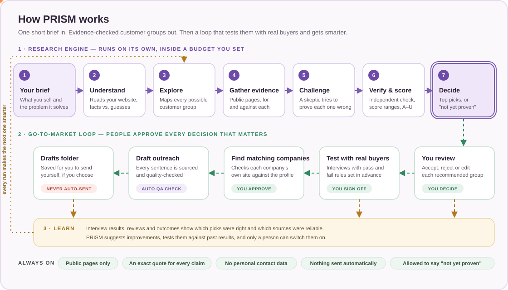
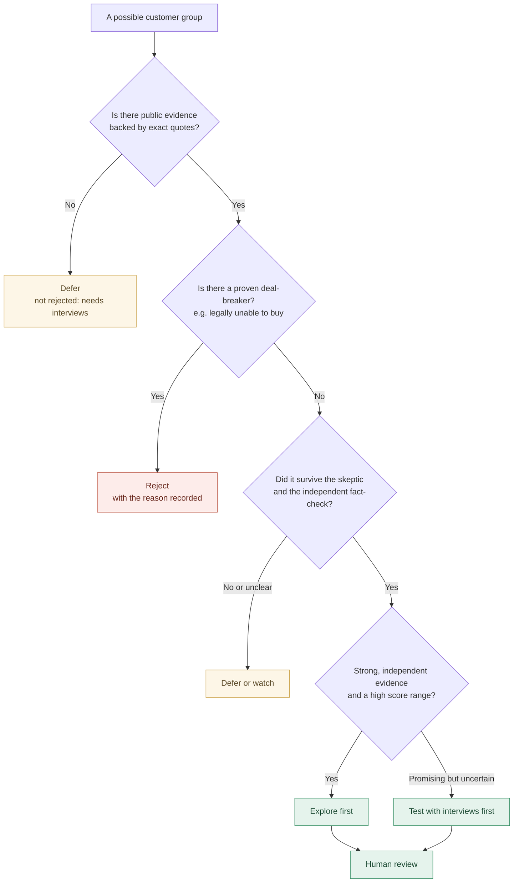
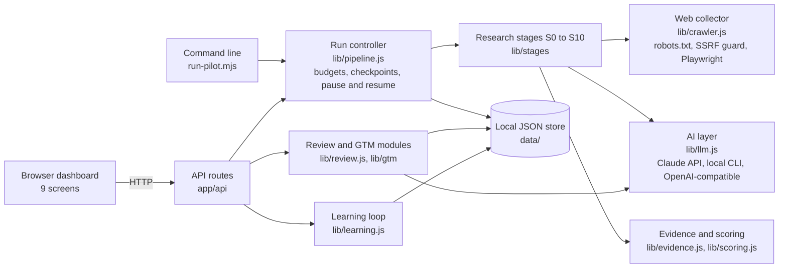

# PRISM

**Find out who your best customers really are, with evidence, before you spend money selling to them.**

PRISM is an evidence-led research and go-to-market system. You describe your business in a sentence or two. PRISM
maps every kind of customer you could sell to, gathers public evidence for and against each one, tries hard to prove
its own ideas wrong, and hands you a short, honest list of customer groups worth testing. It then helps you test
them with real buyers, find matching companies, prepare outreach, and learn from what happens.

<p align="center">
  
</p>

> **The one rule PRISM is built around:** it would rather tell you "not yet proven" than make every market look
> attractive. Research on the web can show where to look. Only real conversations with real buyers can prove that
> people will pay.

---

## Contents

- [In one minute](#in-one-minute)
- [The problem PRISM solves](#the-problem-prism-solves)
- [Who it is for](#who-it-is-for)
- [Where you can use it](#where-you-can-use-it)
- [What you get from one run](#what-you-get-from-one-run)
- [How it works, step by step](#how-it-works-step-by-step)
- [Why you can trust what it tells you](#why-you-can-trust-what-it-tells-you)
- [What PRISM will never do](#what-prism-will-never-do)
- [An illustrative example](#an-illustrative-example)
- [The dashboard, screen by screen](#the-dashboard-screen-by-screen)
- [Getting started](#getting-started)
- [Questions people usually ask](#questions-people-usually-ask)
- [For technical readers](#for-technical-readers)
- [Limits and what comes next](#limits-and-what-comes-next)

---

## In one minute

Most businesses describe their ideal customer too loosely: "SaaS companies", "small businesses", "students". They
buy a contact list, send hundreds of messages, and learn very little when it doesn't work.

PRISM works the other way round:

1. **It starts wide.** It lists every plausible type of customer for each thing you sell, including ones you
   probably haven't considered.
2. **It looks for proof on both sides.** For each group it searches the public web for signs of real pain, budget
   and urgency, and also for reasons it would *not* work: free alternatives, no budget, wrong timing.
3. **It argues with itself.** A separate "skeptic" attacks every promising idea. A separate "fact-checker" checks
   every piece of evidence against the original page.
4. **It gives you a short, honest answer.** Up to three or five groups worth testing, each with a score *range*, an
   evidence grade and its strongest objection. If nothing is strong enough, it says so and tells you what to find
   out next.
5. **It helps you test, act and learn.** Interview plans, sample companies, outreach drafts that you approve and send
   yourself, and a learning loop that gets sharper with every result you record.

An ICP (ideal customer profile) is a precise description of the customers worth going after first. PRISM's job is to
find yours, and to show its working.

## The problem PRISM solves

| What usually goes wrong | What PRISM does instead |
|---|---|
| The target is a vague label ("enterprises") | Splits the market into specific groups, each with a clear buyer, need and trigger |
| Several products get one generic persona | Builds a separate customer map for each product or service |
| Lead lists tell you *who exists*, not *who needs you* | Looks for evidence of pain, budget, timing and alternatives before anyone builds a list |
| AI tools make every market sound promising | A built-in skeptic tries to disprove each idea, and an independent checker verifies every claim |
| A company launching a product or hiring is treated as "ready to buy" | Treats these as timing hints only. Buying intent is never assumed. |
| Made-up statistics and market sizes | Every claim needs an exact quote from a real page; market sizes are never invented |
| Nobody learns from interviews and outreach | Results feed a learning loop that tracks which choices were right |

## Who it is for

- **Founders and first sales or marketing hires** who need to pick a starting market without a research team.
- **Heads of growth, sales and revenue operations** who want a defensible, documented reason for their targeting.
- **GTM engineers and growth teams** who want a repeatable, auditable research workflow instead of one-off prompts.
- **Agencies and consultants** who define target customers for clients and need to show their evidence.
- **Product and marketing leaders** shaping positioning, messaging and which customer jobs to focus on.
- **Accelerators, advisors and investors** who want to pressure-test a company's "who will buy this" story.

You don't need to be technical to use the results. Everything comes out as plain-language cards, a decision memo and
spreadsheets.

## Where you can use it

**Situations**

- Launching a new product, and deciding who to sell to first.
- Entering a new country or region.
- A company with several products that serve different buyers, where each needs its own target.
- Before buying a lead list, hiring salespeople or starting a paid campaign.
- When outbound or ads are underperforming and you suspect the targeting.
- Re-checking your target customers every quarter as markets change (refresh runs show what changed).
- Preparing a go-to-market plan or a pitch that needs evidence behind "our customers are…".

**Types of business**

| Type | Example of what PRISM separates |
|---|---|
| Software sold to businesses (SaaS) | Which company types feel the problem, and who signs off on spend |
| Professional services and agencies | Buyers with deadline-driven needs vs. those with ongoing needs |
| Education and training | Individual learners paying themselves vs. employers or institutions paying for them |
| Consumer subscriptions and apps | Who uses it vs. who pays (for example parents, employers, gift buyers) |
| Marketplaces and platforms | Each side of the market, and channel partners who could resell |
| Hardware, health and regulated products | Buyers whose purchase is driven by rules or certification |

It works for business-to-business, business-to-consumer and mixed models.

## What you get from one run

| Output | What it is, in plain words |
|---|---|
| **Decision memo** | A short report: go, hold or no-go; the recommended customer groups and why; the strongest objection to each; why the others were not picked; what is still unknown. |
| **Customer group cards** | One card per group: who they are, who uses the product vs. who pays, what triggers a purchase, how to recognise a good fit, what rules someone out, the competition, a score range, an evidence grade and the next test to run. |
| **Evidence ledger** | Every claim PRISM relied on, with the exact quote, the source page, the date and whether the independent check confirmed it. |
| **Skeptic's report** | For each top group, the result of 15 deliberate attacks: no real pain, no budget, a free alternative is good enough, wrong timing, and more. |
| **Who not to target** | Groups that were rejected and why, plus the warning signs that rule a company out. |
| **Validation plan** | Interview questions and the pass and fail rules, written *before* you talk to anyone, so the results can't be bent afterwards. |
| **Lead-finding brief** | Search queries, public directories and the criteria for finding matching companies. Criteria, not a scraped contact list. |
| **Run report** | What was searched, what was skipped and why, what it cost, and any limits that were hit. |
| **Spreadsheets** | Customer groups, claims and sources as CSV files, plus the full record as JSON. |

## How it works, step by step

The diagram at the top shows the whole system. Here is what happens at each step.

### Part 1: the research engine (runs on its own)

| Step | What happens | Why it matters |
|---|---|---|
| **1. Your brief** | You give your business name, what you sell and the problem it solves. A website, region and markets to exclude are optional. | You can start in under a minute. Anything missing is marked "unknown" instead of being guessed. |
| **2. Understand** | PRISM reads your own website and builds a business card that keeps three kinds of fact apart: what you said, what your site says (with the exact quote) and what it is only guessing. | You can see straight away if PRISM misunderstood you, and correct it. |
| **3. Explore** | For each product it brainstorms many types of customer: industries, company types, job roles, partners and resellers, life events, individuals and institutions. | Good markets are often not the obvious ones. PRISM looks wide before it narrows. |
| **4. Gather evidence** | It searches the public web for each group, looking both for support (real pain, budget, urgency) and for problems (free alternatives, "not a priority", barriers). It reads the pages politely and keeps the source and date of everything. | Searching for the downside is as important as searching for the upside. Copied articles count as one source, not several. |
| **5. Challenge** | A separate AI "skeptic" receives the best case for each promising group and tries to break it with 15 standard attacks. | This catches wishful thinking before it costs you weeks of outreach. |
| **6. Verify and score** | A separate AI fact-checker looks at each claim next to the original text, without seeing the argument for the group. Then every group gets a score range, an evidence grade and a decision. | The checker can't be swayed by the sales pitch, and the score shows its uncertainty instead of hiding it. |
| **7. Decide** | PRISM picks up to three or five groups, spread across your products, or none. It writes the decision memo, the who-not-to-target list, the validation plan and the lead-finding brief. | Recommending nothing is allowed. A clear "not yet" with a plan beats a confident wrong answer. |

You set a budget for each run (pages read, searches, AI calls, money and time). You can pause, resume or cancel at any
point, and a run picks up where it left off.

### Part 2: the go-to-market loop (people stay in control)

| Step | What happens | Who decides |
|---|---|---|
| **Review** | You accept, reject (with a reason), edit or ask for deeper research on each recommended group. | You |
| **Test with real buyers** | You run the interviews from the validation plan and log each one. You close the test as passed, failed or inconclusive against the rules set in advance. A group is only marked "validated" after a passed test and your sign-off. | You |
| **Find matching companies** | For an accepted group, PRISM finds real organizations and checks each company's own website against the profile, quoting what it found. It looks at companies only, never individual people. | You approve each company |
| **Draft outreach** | For approved companies it writes a short three-email sequence. Every sentence is labelled: a fact about them (with its source), a fact about you, or plain connecting text. An automatic check blocks invented numbers, hype and anything unsourced. | Automatic check, then you |
| **Drafts folder** | Finished drafts are saved as email files on your computer for you to review and send yourself. | You. Nothing is sent automatically. |

### Part 3: learning (gets better over time)

Every review, interview and outcome you record becomes a "known answer". PRISM uses them to measure which of its
recommendations turned out right, which sources were reliable, and how many recommended groups were validated.
It then suggests small improvements, such as trusting a weak source less or ruling out a type of company that keeps
failing. Each suggestion is tested against past results first, and **only a person can switch it on.** Any change
can be rolled back in one click.

### A closer look: how each customer group gets its verdict



## Why you can trust what it tells you

**Every claim has a quote.** PRISM only keeps a piece of evidence if the exact sentence can be found on a page it
actually read. If an AI invents a quote, the claim is thrown out and logged.

**Two independent checks.** One AI argues against each idea (the skeptic). A different AI checks each claim against
the original text without seeing the argument for it (the fact-checker).

**Copies don't count twice.** Ten websites repeating the same press release are treated as one source.

**Uncertainty is shown, not hidden.** Instead of a misleading "95% fit", each group gets a score range from 0 to 100,
such as 45–80. The wider the range, the less PRISM knows.

**Evidence grades.** These describe how well the facts are supported. They do not tell you whether people will pay.

| Grade | Meaning |
|---|---|
| **A** | Strong original evidence, confirmed by independent sources, no unresolved contradictions |
| **B** | Credible evidence, but not yet independently confirmed |
| **C** | Plausible but indirect, or only partly checked |
| **D** | Weak, contradictory, or mainly the vendor's own marketing |
| **U** | Unknown: nothing usable was found |

**Decisions.**

| Decision | What it means for you |
|---|---|
| **Explore first** | Strong, independent evidence and it survived the skeptic. Start your interviews here. |
| **Test with interviews first** | Promising but uncertain. Talk to buyers before investing more. |
| **Defer or watch** | Not enough evidence either way. Missing evidence is never treated as a "no". |
| **Reject** | A proven deal-breaker, or strong evidence that it's a poor fit. The reason is recorded. |

**Buying intent is never assumed.** A company launching a product, raising money or hiring is recorded as a timing
hint only. PRISM never labels a company "ready to buy" from web research.

**Everything is traceable.** Every recommendation links back to its claims, every claim links back to its quote and
page, and every human decision records who made it and why.

## What PRISM will never do

- Send emails or messages to anyone.
- Collect personal names, email addresses or phone numbers. It works with companies and job roles only.
- Scrape LinkedIn, contact-data vendors, logged-in pages, paywalls or anything behind a CAPTCHA.
- Ignore a website's robots.txt (the file where sites say what automated readers may access).
- Invent market sizes, budgets, customer counts or conversion rates.
- Mark a customer group "validated" without a passed real-world test and a person's sign-off.
- Change its own safety, privacy or source rules through learning.

## An illustrative example

*Illustration only: this shows the shape of PRISM's output, not the result of a real run.*

Imagine a company that sells appointment-scheduling software to physiotherapy clinics. Its brief says: "We sell
online booking and reminders that reduce missed appointments."

- **Explore** might produce: independent clinics with one or two locations, multi-site clinic chains, sports-injury
  practices attached to gyms, clinic-management consultants who could resell, and patients booking for themselves.
- **Gather evidence** might find practitioner forums complaining about no-shows (support), a professional association
  page about booking rules (context), and threads where small clinics say a free calendar is "good enough" (against).
- **Challenge** might flag that small clinics are price-sensitive and that the person feeling the pain (the front
  desk) is not the person who pays (the owner).
- **The card** for "multi-site physiotherapy chains" might read:

| Field | Example |
|---|---|
| Who | Physiotherapy groups with three or more locations and a central admin team |
| User vs. buyer | Front-desk staff use it; the operations manager or owner pays |
| Trigger | Opening a new location; a rise in missed appointments |
| Fit signs | Online booking on their website; several locations listed; job ads for clinic admin roles |
| Rule out if | Single practitioner; booking handled by a hospital system |
| Score range | 55–78 |
| Evidence grade | B |
| Strongest objection | Larger chains may already be locked into practice-management suites |
| Decision | Test with interviews first |
| Next step | Interview five operations managers about the last month of missed appointments and who chose their current tool |

## The dashboard, screen by screen

| Screen | What you see | What you can do |
|---|---|---|
| **Cockpit** | Live progress through each step, money and pages used against the budget, an activity log, and a grid showing which questions were researched for each group | Pause, resume, cancel, or refresh a past run |
| **ICPs** | The recommended groups, a watchlist, and every other group with its card, score range, grade and decision | Accept, reject, edit, ask for deeper research, find matching companies |
| **Evidence** | Every claim with its quote, source and check result; every page read; discarded claims; skipped pages | Flag a claim as wrong |
| **Red team** | The skeptic's 15 tests for each top group, with notes and quotes | Read the strongest case for and against |
| **Validation** | The interview plans with pass and fail rules | Start a test, log interviews, close it, mark a group validated |
| **Accounts** | Matching companies grouped by stage, with quoted fit checks and outreach drafts | Approve or reject companies, create drafts, save them to the drafts folder |
| **Learning** | How often recommendations proved right, source reliability, suggested improvements and their test results | Record outcomes, approve or reject improvements, roll back |
| **Runs** | All past runs | Compare two runs side by side; download the memo and spreadsheets |
| **Business** | The business card PRISM built from your brief and website, and the rules each run followed | Check what PRISM understood about you |

## Getting started

### What you need

- A computer with [Node.js](https://nodejs.org) version 22 or newer (24 recommended).
- An AI model. The easiest option is the [Claude Code](https://code.claude.com) command-line tool, installed and
  signed in: PRISM uses it directly, so no API key is needed. You can also use an API key (see below).
- About 10 minutes for the first setup.

### Install and open

Open a terminal in the project folder and run these one at a time:

```bash
npm install
```

```bash
npx playwright install chromium
```

```bash
npm run seed
```

```bash
npm run dev
```

Then open http://localhost:3000 in your browser.

`npm run seed` loads a small demo run built from made-up data, so you can click through every screen without
internet access or an AI. When you're ready, press **New research** and describe your own business.

### Choose the AI it uses

Create a file called `.env.local` in the project folder if you want to change the default:

```env
PRISM_LLM=auto            # auto, anthropic, claude-cli, openai or none
ANTHROPIC_API_KEY=...     # use the Claude API directly
PRISM_MODEL=...           # pick a specific model
OPENAI_API_KEY=...        # or any OpenAI-compatible service
OPENAI_BASE_URL=...
SEARXNG_URL=http://localhost:8080   # optional: your own search engine for broader, more reliable search
PRISM_OWN_INBOX=you@yourcompany.com # optional: drafts are addressed to you for review
```

With `auto`, PRISM uses an API key if one is set, otherwise the signed-in command-line tool. With no AI at all, it
still reads pages and plans the research, but it can't verify anything, so it recommends nothing and tells you why.

### Run sizes

| Mode | When to use it | Budget per run |
|---|---|---|
| **Quick** | A first look; two customer groups per product | 12 pages · 8 searches · 12 AI calls · $1.50 cap |
| **Discovery** | The normal full run | 40 pages · 30 searches · 40 AI calls · $6 cap |
| **Deep** | Dig into one group and its borderline cases (the "Deepen" button) | 70 pages · 50 searches · 60 AI calls · $12 cap |
| **Refresh** | Re-check a past run's sources and see what changed | 40 pages · 20 AI calls · $4 cap |

In testing, a quick run took about 15 minutes and used under $2 of AI credit. Larger runs read more and take longer.

### Your first run

1. Press **New research**.
2. Fill in your business name, what you sell and the problem it solves. Add your website if you have one.
3. Choose a region and run size, and optionally list markets to exclude.
4. Watch the **Cockpit** while it works. Open **ICPs** when it finishes.
5. Read the decision memo (Runs, then Export), review each group, and start with the validation plan.

## Questions people usually ask

**What if it recommends nothing?**
That's a real answer, not a failure. It means the public evidence wasn't strong enough to back any group. You get a
list of what's missing and an interview plan to find out. That's usually the cheapest moment to learn it.

**Will it contact anyone?**
No. It never sends anything. Drafts are saved as files for you to read, edit and send yourself if you choose.

**Does it collect people's contact details?**
No. It looks at companies and job roles only.

**How is this different from a lead database or a list-building tool?**
Those tools tell you who exists. PRISM decides which groups are worth building a list for, with evidence, and gives
you the criteria to find them. It's the step before the list.

**How is it different from asking a chatbot "who is my ideal customer"?**
A chatbot answers from memory and tends to agree with you. PRISM reads real pages, keeps the quotes, argues against
itself, checks every claim independently, shows its uncertainty and is allowed to say no.

**Can it be wrong?**
Yes. The public web over-represents companies that are visible online and writing in English. That's why every
recommendation comes with its objections and a plan to test it with real buyers before you invest.

**Where is my data stored?**
On your own computer, in the `data/` folder. Nothing is uploaded except the AI calls and the public web requests the
research makes.

**How long and how much?**
A quick run took about 15 minutes and under $2 of AI usage in testing. You set a hard budget for every run.

## For technical readers

### Architecture



The controller, not the AI, owns stage order, budgets, retries and approval gates. Each AI role (intake,
cartographer, extractor, analyst, skeptic, verifier, designer, account qualifier, outreach drafter) is a separate call
with its own instructions and a strict JSON schema. Page text is treated as untrusted data: instruction-like sentences
are stripped and flagged before any model sees them.

### Internal stage map

| Code | Stage | Plain-language step |
|---|---|---|
| S0 | Policy and budgets | (set-up) |
| S1 | Business understanding | 2. Understand |
| S2 | Market universe | 3. Explore |
| S3 | Query plan and coverage grid | 3. Explore |
| S4 | Collection and provenance | 4. Gather evidence |
| S5 | Claim extraction and entity resolution | 4. Gather evidence |
| S6 | Hypothesis cards | Builds each group's card before the challenge |
| S7 | Competition and economics | Maps competitors and substitutes before the challenge |
| S8 | Red team | 5. Challenge |
| S9 | Independent verification and scoring | 6. Verify and score |
| S10 | Portfolio, validation sprint, lead brief | 7. Decide |
| S11 | Human review | Go-to-market loop |
| S12 | Outcome learning | Learning |

Refresh runs use their own stages: re-check sources (R1), carry over hypotheses (R2) and report the delta (R3).

### Project layout

| Path | What lives there |
|---|---|
| `app/` | Next.js dashboard (`dashboard.jsx`, `components/`) and API routes (`api/`) |
| `lib/pipeline.js` | Run controller |
| `lib/stages/` | One file per group of stages: intake, explore, collect, analyze, challenge, decide, refresh |
| `lib/llm.js`, `lib/schemas.js`, `lib/prompts.js` | AI provider layer, output schemas, role instructions |
| `lib/crawler.js` | Public-web collection and search adapters |
| `lib/evidence.js`, `lib/scoring.js` | Source tiers, quote checks, origin families, entity resolution, grades, score ranges, decisions |
| `lib/policy.js`, `lib/taxonomy.js` | Run modes, budgets, blocked domains; research angles, red-team tests, reason codes |
| `lib/review.js` | Human review, evidence flags, experiments, validation |
| `lib/gtm/` | Account qualification state machine, outreach drafting, copy QA, drafts folder |
| `lib/learning.js` | Feedback, outcomes, calibration, improvement proposals, strategy versions |
| `lib/reports.js` | Decision memo, adversarial report, validation plan, lead brief, run report, CSV exports |
| `lib/store.js` | Atomic JSON storage under `data/` |
| `test/`, `fixtures/` | Offline test suite with a fake web and a fake AI |
| `examples/brief.example.json` | A sample brief for the command line |
| `docs/PRD_COVERAGE.md` | Requirement-by-requirement status against the product spec |
| `Autonomous_ICP_Discovery_PRD_v1.md` | The full product requirements document |
| `engine.js`, `planner.js`, `evidence.js`, `report.js`, `cli.js` | The original offline scoring engine, kept for compatibility |

### Command line

```bash
node run-pilot.mjs --brief examples/brief.example.json
```

Add `--mode quick|discovery|deep` to choose the run size. The run is saved under `data/` and shows up in the dashboard.

### API

| Method and path | Purpose |
|---|---|
| `GET /api/runs` | List runs |
| `POST /api/runs` | Start a run: `{name, offer, problem, website?, geography?, model?, mode?, topCount?, excludedMarkets?}` |
| `GET /api/runs/:id` | Full run record |
| `POST /api/runs/:id` | Actions by `type`: `control`, `refresh`, `deepen`, `review`, `flag`, `experiment`, `validate`, `findAccounts` |
| `GET /api/runs/:id/export?format=` | `memo`, `json`, `claims`, `sources`, `icps`, `lead-brief` |
| `GET /api/workspace` | Accounts, drafts folder, learning metrics, strategy, jobs, health |
| `POST /api/workspace` | Actions by `type`: `account`, `learning`, `outcome`, `suppress` |
| `GET /api/compare?a=&b=` | Compare two runs |

Human actions must include an `actor` of the form `human:<name>`. The code refuses approvals from anything else.

### Tests

```bash
npm test
```

23 tests run fully offline against a fake web and a fake AI. They check that:

- blocked sites are never fetched;
- invented quotes are rejected, and copied articles count once;
- similar company names are not merged;
- proven deal-breakers reject a group, while missing evidence defers it;
- zero recommendations is allowed, and the same inputs give the same decisions;
- runs can be cancelled between stages;
- a product launch is never treated as buying intent;
- approvals are human-only, and outreach QA blocks unsourced or hyped copy;
- learning changes can't go live without a person.

## Limits and what comes next

- **Single user, on one computer.** There are no team logins or permissions yet.
- **Public, English-language web only.** No government registries, paid databases or PDF reading yet.
- **Search quality depends on free public search engines.** Connecting your own SearXNG instance helps.
- **Refresh runs are started by hand.** They are not scheduled yet.
- **No market-size estimate.** PRISM won't produce a market-size estimate until it can build one from sourced numbers.

See [docs/PRD_COVERAGE.md](docs/PRD_COVERAGE.md) for the full list of what is built, partly built and planned.

`data/`, `.env.local` and `.next/` are kept out of version control. Released under the MIT License.
